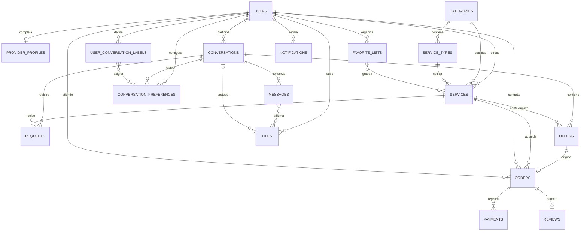

# Modelo de datos

Fuente del estado: `db.json`. Fuente de interfaces del cliente: `shared/models.ts`. Validación efectiva: `server/app.cjs`. IDs son strings: UUID para nuevos registros, IDs legibles reservados en la semilla. Fechas de eventos ISO UTC; moneda implícita PEN, importes enteros positivos en céntimos. No hay SQL ni restricciones de clave foránea automáticas.

En las tablas, **Sí** significa requerido al crear el registro válido; **No** es opcional; **D** indica calculado al consultar, no persistido como fuente de verdad. Los arrays requeridos pueden estar vacíos donde se indica.

## Identidad y catálogo

| Entidad            | Atributo                                            | Tipo                             | Requerido / regla                                             |
| ------------------ | --------------------------------------------------- | -------------------------------- | ------------------------------------------------------------- |
| users              | id, name, email                                     | string                           | Sí; email único normalizado; name ≥2                          |
| users              | passwordHash                                        | string `salt:hash`               | Sí; scrypt, privado; no forma parte del DTO User              |
| users              | providerEnabled                                     | boolean                          | Sí; solo habilita perfil completo                             |
| users              | labelsInitialized                                   | boolean                          | No; evita recrear etiquetas iniciales que el usuario borró    |
| users              | createdAt                                           | ISO string                       | Sí                                                            |
| providerProfiles   | id, userId                                          | string                           | Sí; un perfil por usuario                                     |
| providerProfiles   | name, headline, region, about                       | string                           | Sí para completar; headline ≥5, about ≥30                     |
| providerProfiles   | zones                                               | string                           | No; zona general, puede estar vacía                           |
| providerProfiles   | skills                                              | string[]                         | Sí para completar; al menos una                               |
| providerProfiles   | languages                                           | `{name,level}[]`                 | Sí para completar; nivel básico/intermedio/avanzado, máximo 8 |
| providerProfiles   | avatarId                                            | files.id                         | No; archivo público propio                                    |
| providerProfiles   | experience, education, certifications, availability | string                           | No; se persisten vacíos, se ocultan secciones vacías          |
| providerProfiles   | completed                                           | boolean                          | Sí; progreso puede ser false                                  |
| categories         | id, name, illustration, color, light                | string                           | Sí; seis categorías de solo lectura                           |
| serviceTypes       | id, categoryId, name                                | string                           | Sí; tipo debe pertenecer a categoría                          |
| services           | id, providerId, categoryId, typeId                  | string                           | Sí; dueño desde sesión, referencias verificadas               |
| services           | title                                               | string                           | Sí, 6–500 caracteres                                          |
| services           | modality                                            | digital / presencial             | Sí                                                            |
| services           | region, zones                                       | string                           | Obligatorios al publicar presencial; vacíos en digital        |
| services           | description, requirements                           | string                           | Al publicar ≥30 y ≥5; máximo 6000 y 500                       |
| services           | tags                                                | string[]                         | Sí; vacío permitido, máximo 30                                |
| services           | cover                                               | string                           | Sí; fallback local de semilla, no URL arbitraria del cliente  |
| services           | imageIds                                            | files.id[]                       | Sí; orden determina portada, vacía permitida                  |
| services           | packages                                            | Package[3]                       | Sí; Básico, Estándar, Premium                                 |
| services           | extras                                              | Extra[]                          | Sí; vacía permitida, máximo 10                                |
| services           | faq                                                 | `{question,answer}[]`            | Sí; vacío permitido, máximo 10; entradas completas            |
| services           | status                                              | draft / published / paused       | Sí                                                            |
| services           | createdAt                                           | ISO string                       | Sí                                                            |
| Package (embebido) | id, name, scope                                     | string                           | Sí; IDs locales paquete-1..3; scope ≥10 al publicar           |
| Package            | priceCents, days, revisions                         | integer                          | Sí; precio >0, días 1..365, revisiones 0..50 (0 presencial)   |
| Package            | unit                                                | proyecto / hora / visita         | Sí                                                            |
| Package            | bookingMode                                         | direct / request                 | Sí                                                            |
| Package            | features                                            | string[]                         | Sí; lista de incluidos                                        |
| Extra (embebido)   | id, name, priceCents, days                          | string, string, integer, integer | Sí; precio >0; días 0..365; ID único dentro del servicio      |

Paquetes, extras, tags y FAQ se embeben porque se editan como una unidad pequeña. Un packageId o extraId solo tiene significado dentro de su servicio. No se crean colecciones serviceTags ni favoriteListItems: se documenta su representación equivalente.

## Conversaciones y acuerdos

| Entidad                 | Atributo                                                         | Tipo                                                         | Requerido / regla                                                                 |
| ----------------------- | ---------------------------------------------------------------- | ------------------------------------------------------------ | --------------------------------------------------------------------------------- |
| conversations           | id, participantIds                                               | string, string[2]                                            | Sí; pareja única y distinta                                                       |
| conversations           | customerId, providerId                                           | users.id                                                     | Sí; último contexto comercial; no son roles globales                              |
| conversations           | createdAt, updatedAt                                             | ISO string                                                   | Sí                                                                                |
| conversations           | lastMessage                                                      | string                                                       | D; extracto del último registro, solo participantes                               |
| messages                | id, conversationId, authorId, authorName                         | string                                                       | Sí; autor de sesión o system                                                      |
| messages                | contextCustomerId, contextProviderId                             | users.id                                                     | Sí en nuevos; opcionales en datos previos, se preservan antes de cambiar contexto |
| messages                | kind                                                             | text / request / offer / event                               | Sí; cliente solo crea text por CRUD                                               |
| messages                | text, fileIds                                                    | string, files.id[]                                           | Sí; al menos texto o imagen en mensaje de usuario                                 |
| messages                | referenceId, replyToId                                           | string                                                       | No; referencia contextual según kind y cita del mismo chat                        |
| messages                | createdAt                                                        | ISO string                                                   | Sí                                                                                |
| conversationPreferences | id, userId, conversationId                                       | string                                                       | Sí; combinación única                                                             |
| conversationPreferences | folder                                                           | inbox / archived / spam / deleted                            | Sí; acción solo personal                                                          |
| conversationPreferences | starred, unread                                                  | boolean                                                      | Sí                                                                                |
| conversationPreferences | readAt                                                           | ISO string o vacío                                           | Sí; actualizado al marcar leído                                                   |
| conversationPreferences | labelIds, savedMessageIds                                        | string[]                                                     | Sí; propios y del chat, sin duplicados                                            |
| userConversationLabels  | id, userId, name, description                                    | string                                                       | Sí; descripción puede estar vacía; nombre ≥2                                      |
| requests                | id, conversationId, customerId, providerId, serviceId, packageId | string                                                       | Sí                                                                                |
| requests                | snapshot                                                         | `{title,packageName}`                                        | Sí; contexto al solicitar                                                         |
| requests                | text, fileIds, createdAt                                         | string, files.id[], ISO                                      | Sí; texto ≥10                                                                     |
| offers                  | id, conversationId, serviceId, providerId, customerId            | string                                                       | Sí                                                                                |
| offers                  | title, scope                                                     | string                                                       | Sí; ≥5 y ≥10 respectivamente                                                      |
| offers                  | totalCents, days                                                 | integer                                                      | Sí; precio cerrado >0, plazo 1..365                                               |
| offers                  | paymentMode                                                      | platform / onsite                                            | Sí; onsite solo en servicio presencial                                            |
| offers                  | expiresAt, createdAt                                             | ISO string                                                   | Sí; vence en futuro al crear                                                      |
| offers                  | status                                                           | pending / accepted / rejected / withdrawn                    | Sí; `expired` se deriva al consultar si superó expiresAt                          |
| offers                  | orderId                                                          | orders.id                                                    | No; presente al aceptar mediante checkout                                         |
| orders                  | id, customerId, providerId, serviceId, conversationId            | string                                                       | Sí; identidades históricas                                                        |
| orders                  | offerId                                                          | offers.id                                                    | No; máximo un pedido por oferta                                                   |
| orders                  | snapshot                                                         | OrderSnapshot                                                | Sí; copia independiente de la ficha actual                                        |
| orders                  | totalCents, requirements                                         | integer, string                                              | Sí; total recalculado y requisitos ≥5                                             |
| orders                  | status                                                           | agreed / in_progress / delivered / completed / cancelled     | Sí; transiciones verificadas                                                      |
| orders                  | paymentMode                                                      | platform / onsite                                            | Sí                                                                                |
| orders                  | paymentStatus                                                    | paid / pending / confirmation_pending / confirmed / refunded | Sí; independiente del trabajo                                                     |
| orders                  | requestedAt, confirmedAt, address                                | ISO, ISO, string                                             | Opcionales; requestedAt y address requeridos presencial                           |
| orders                  | dueAt, createdAt                                                 | ISO string                                                   | Sí; dueAt desde plazo del acuerdo                                                 |
| orders                  | startedAt                                                        | ISO string                                                   | No; permite reseña tras cancelación                                               |
| orders                  | events                                                           | OrderEvent[]                                                 | Sí; nunca se reemplaza desde el cliente                                           |
| orders                  | idempotencyKey                                                   | string                                                       | Sí; ≥8, exclusiva por customerId al confirmar                                     |
| OrderSnapshot           | title, providerName, packageName, scope, modality                | string                                                       | Sí; sin referencias mutables a la ficha                                           |
| OrderSnapshot           | customerName                                                     | string                                                       | No en datos antiguos, sí en nuevos acuerdos/semilla                               |
| OrderSnapshot           | unitPriceCents, quantity, extras                                 | integer, integer, Extra[]                                    | Sí; cantidad 1..100; oferta usa cantidad 1                                        |
| OrderEvent              | action, actorId, at, note                                        | string                                                       | Sí; nota puede ser vacía salvo ajuste/cancelación                                 |
| payments                | id, orderId, customerId, providerId, title                       | string                                                       | Sí                                                                                |
| payments                | amountCents, status, createdAt                                   | integer, string, ISO                                         | Sí; paid/confirmed/refunded; no incluye números de tarjeta                        |

## Reputación, listas, actividad y archivos

| Entidad       | Atributo                                                   | Tipo                                    | Requerido / regla                                                |
| ------------- | ---------------------------------------------------------- | --------------------------------------- | ---------------------------------------------------------------- |
| reviews       | id, orderId, serviceId, providerId, customerId, authorName | string                                  | Sí; orderId único                                                |
| reviews       | rating, comment, cancelled, createdAt                      | integer, string, boolean, ISO           | Sí; 1..5, comentario ≥10, elegibilidad desde pedido              |
| reviews       | response                                                   | string                                  | No; solo provider del pedido                                     |
| favoriteLists | id, userId, name, description, createdAt                   | string                                  | Sí; nombre ≥2, descripción puede estar vacía                     |
| favoriteLists | serviceIds                                                 | services.id[]                           | Sí; orden de adición sin duplicados; portada derivada del último |
| favoriteLists | shareToken                                                 | string aleatorio                        | No; 24 bytes en hexadecimal; se elimina al revocar               |
| notifications | id, userId, title, url, read, createdAt                    | string/string/string/string/boolean/ISO | Sí; destino generado por backend, solo dueño marca leído         |
| files         | id, ownerId, key, mime, size, createdAt                    | string/string/string/string/integer/ISO | Sí; key interna relativa; tamaño ≤5 MiB                          |
| files         | visibility, conversationId                                 | public/private, string                  | Sí / requerida para privada                                      |
| files         | url                                                        | string                                  | Sí; `/api/files/:id/content`, nunca ruta de Windows              |
| Metrics DTO   | rating, reviewCount, completed, savedCount                 | number                                  | D; reseñas, pedidos completados y personas distintas             |
| Metrics DTO   | level                                                      | string                                  | D; Nuevo/Nivel 1/Nivel 2/Top Rated                               |
| Metrics DTO   | responseMinutes                                            | number o null                           | D; pares de mensajes de cliente/provider; eventos excluidos      |

Las sesiones (token, userId, expiresAt) y contadores de intentos se almacenan en memoria, fuera de db.json. Los datos de demostración son ficticios. Los nombres de reseñas y acuerdos son snapshots de presentación; `users.name` y `providerProfiles.name` se actualizan juntos en edición.

## Relaciones (pata de gallo)

Las relaciones M:N se representan con arrays de IDs. La participación de conversación tiene exactamente dos IDs, regla de aplicación no expresable por completo con esta cardinalidad genérica. Paquetes, extras, snapshots y eventos son valores embebidos, no entidades independientes.
