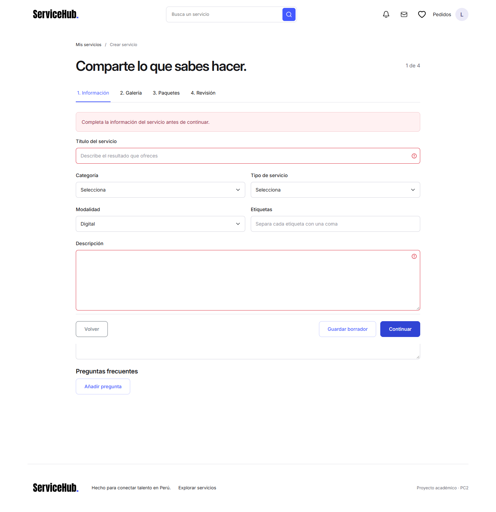
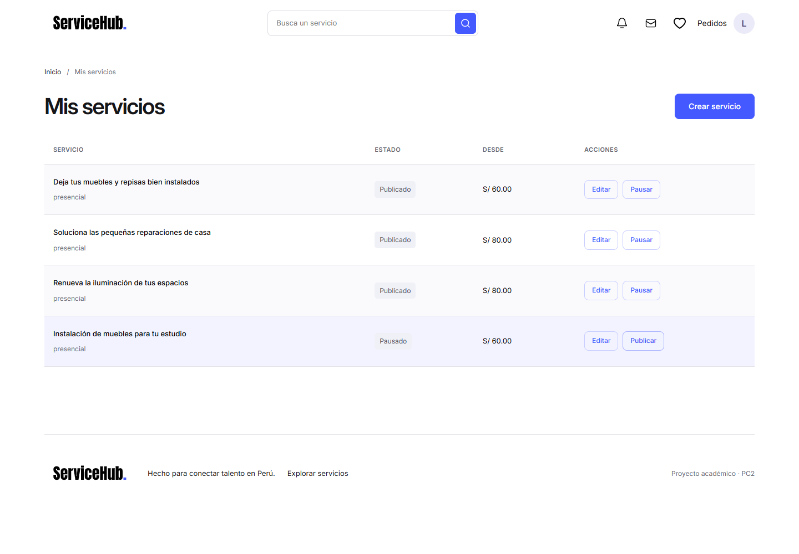
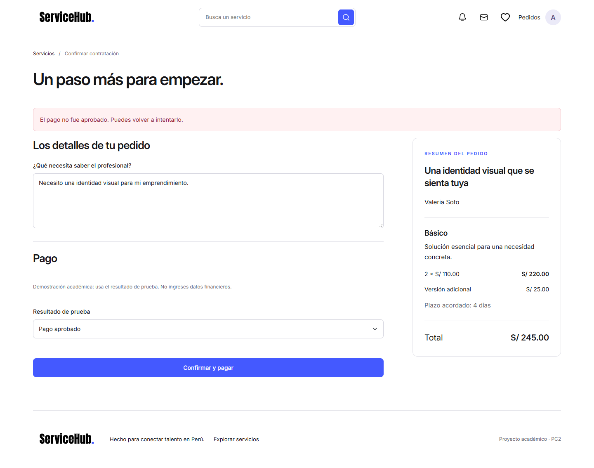
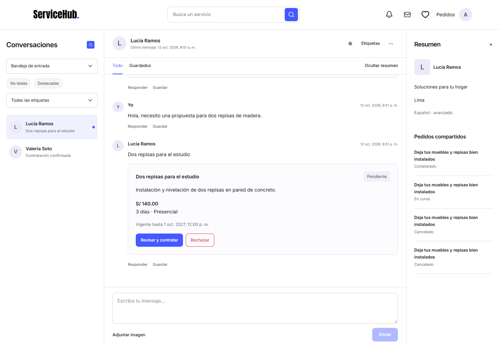

# ServiceHub · Práctica Calificada 2

**Curso:** JavaScript Avanzado · Ingeniería de Sistemas, ciclo VI.  
**Entrega:** primera implementación integrada, 12 de octubre de 2026.  
**Autores:** equipo de cinco estudiantes (nombres por completar por el equipo).

## 1. Necesidad y solución

ServiceHub permite encontrar y contratar servicios digitales o presenciales en Perú. Cliente y profesional coordinan mediante conversaciones, ofertas y pedidos con historial. Un profesional también puede contratar servicios de otra persona. La demostración utiliza únicamente datos ficticios y pagos simulados.

Angular 20.3.33, TypeScript 5.9.3 y Bootstrap 5.3.8 componen la SPA. JSON Server 0.17.4 proporciona el router REST real y persiste en db.json. La identidad visual procede de Home/Guidelines del Figma del usuario; se conservan logo, collage e ilustraciones, con Inter local.

## 2. Estructura del proyecto

- `src/app/core`: servicios HTTP por dominio, sesión y guards.
- `src/app/layouts`: estructura común, navegación y tema.
- `src/app/shared`: ServiceCard, diálogos, feedback, pipe y directiva.
- `src/app/features`: catálogo, auth, perfiles, publicación, listas, mensajes, contratación y pedidos.
- `shared/models.ts`: contratos TypeScript.
- `server/`: arranque del router JSON Server, validación/acceso y acciones compuestas.
- `db.json`: colecciones con siete cuentas, seis perfiles/categorías y dieciocho servicios iniciales.
- `public/assets`: recursos ejecutables; `plan/` permanece como referencia original privada del proyecto.

El routing Angular decide vistas con carga diferida; el routing JSON Server decide recursos REST. Los guards no sustituyen la autorización del backend.

## 3. REST, formularios y persistencia

HttpClient devuelve Observables desde los servicios de dominio. Catálogo y tablas hacen GET; el editor usa POST/PATCH/DELETE de servicios, con autor de sesión y validación del servidor. La API se monta bajo `/api`, con proxy de desarrollo 4200→3000. Las consultas verificadas de JSON Server usan `_page`, `_limit`, `_sort`, `_order`, array de respuesta y headers X-Total-Count/Link.

Las acciones compuestas de checkout calculan el total, conservan snapshot e impiden duplicar una oferta. Sesión HttpOnly y hash scrypt; lectura de chat/archivos exige participación. El db y las imágenes sobreviven al reiniciar. No se resetean automáticamente y los tests utilizan otra base temporal.

Reactive Forms valida datos antes de publicar. Feedback usa `*ngIf` importando NgIf, Bootstrap alerts y mensajes concretos. La tabla profesional usa `table table-striped table-hover`.

## 4. Pipe, directiva y recorrido integrado

`precioSoles` recibe céntimos y formatea PEN con Intl; se usa en catálogo, paquetes, checkout y pedidos. En el ejemplo, **11000 × 2 + 2500 = 24500 céntimos = S/ 245.00**. La directiva `appServiceHighlight` resalta hover/foco de la tarjeta conservando navegación y guardado independientes.

El recorrido admite compra directa o solicitud → conversación → oferta → contratación. El profesional inicia/entrega; el cliente confirma o pide ajuste. Cancelar conserva historial. Reseñas de completado o cancelado tras inicio, respuesta profesional, listas compartidas revocables y movimientos CSV completan el flujo.

## 5. Verificación

Instalación limpia y build correctos. **5/5 unitarios, 14/14 API, 6/6 E2E en Edge**. Pruebas cubren CRUD, capacidades, permisos, importes, idempotencia, estados, reseñas, listas, archivos privados, fallo de escritura, reinicio y dos contextos de navegador. Responsive Home/detalle a 390 y 768, desktop 1440 y chat 390; Escape y devolución de foco en overlays comprobados.

Se generaron **18 capturas PNG reales**. El PDF se produce con `scripts/generate-report.py` a partir de esta estructura y esos archivos, incluyendo recortes explícitos para mantener legibilidad; las capturas originales quedan completas. El documento se renderiza e inspecciona visualmente antes de entregar.

## 6. Alcance y continuación

El build advierte **600.83 kB iniciales** frente al presupuesto de 500 kB; no hay error. La instalación final reportó cero vulnerabilidades conocidas tras fijar correcciones compatibles y overrides documentados. Las sesiones viven en memoria; no hay transacciones ACID ni pagos reales. Fecha/hora se muestra en Lima, pero los filtros por día todavía comparan UTC.

Pendientes concretos: reducir CSS inicial; ampliar QA de accesibilidad/móvil; portadas reales; trayectoria de perfil estructurada; agregados en perfil público; retención/decodificación completa de imágenes; mayor separación de extensiones backend y de efectos secundarios. Los módulos y prioridades se detallan en `../estado-actual.md` y `../../CONTRIBUTING.md`.

Para demostrar: `npm ci`, `npm start`, abrir `http://127.0.0.1:4200`. Cliente `cliente@servicehub.test`, profesional `profesional@servicehub.test`, contraseña común `ServiceHub123!`. Para repetir pruebas: build, `npm test`, `npm run test:e2e`. No hay commit/push realizado por el agente.

La matriz `matriz-cumplimiento.md` relaciona cada requisito oficial con los archivos, vistas, pruebas y capturas correspondientes.
